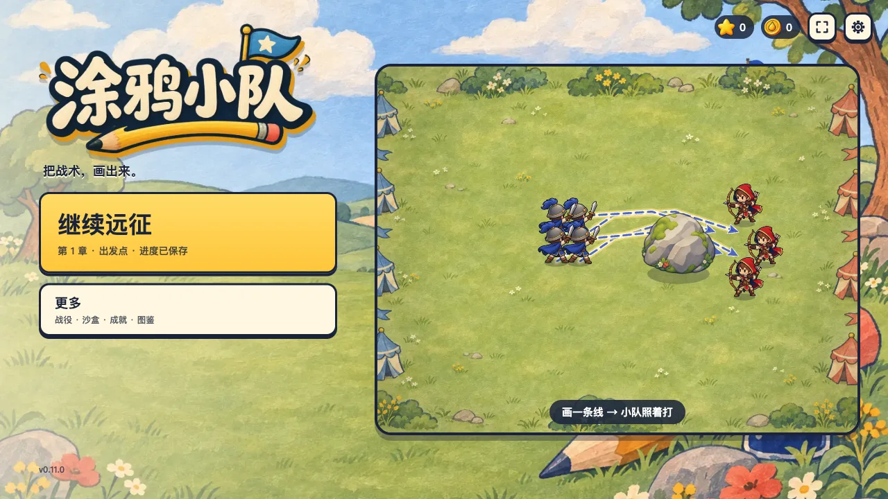
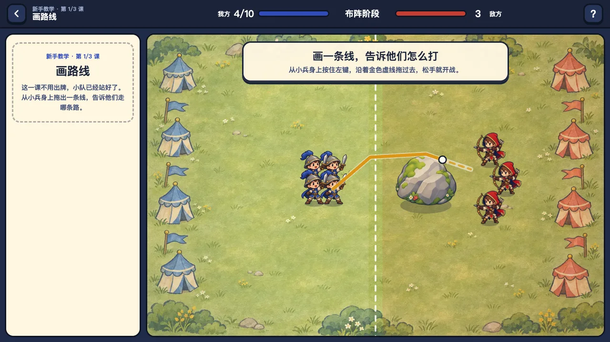
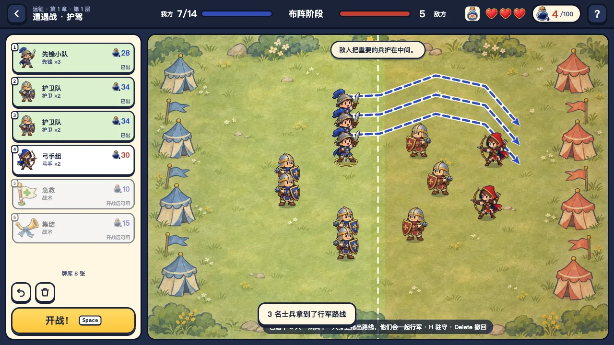
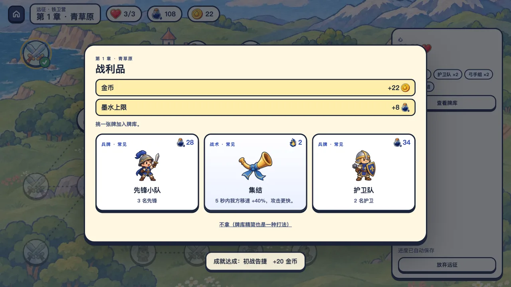

# 涂鸦小队

用有限的墨水画出你的小队，再给他们画好行军路线；开战后士兵自己沿线行军、寻敌作战。原创战术游戏，现在是**电脑版**：横屏、鼠标操作，主打肉鸽卡牌式的“远征”，另有 40 关战役。第一次打开就是一场十几秒的教学小仗。纯原生 JavaScript + Canvas 2D，没有任何运行时依赖。

<p>
  
  
  
  
</p>

**在线试玩：<https://doodle-battles-h5.pages.dev>**（请用电脑浏览器打开；界面按 1280×720 设计，会随窗口等比缩放；页面暂时不会被搜索引擎收录）

当前版本：**0.12.0**（卡牌远征原型，界面只有中文）。单机游戏，没有账号、联网对战、广告或付费，进度只保存在当前浏览器。

## 核心玩法：把战术画出来

- **画路线**：从士兵身上按住左键拖出一条线，开战后他沿线行军，射程内有敌人才停下来打，走完路线后照常寻敌。绕后、诱敌、集火都靠画。
- **出兵**：远征里把手牌拖到战场上，一次放下一整支小队；战役里选好兵种，在左侧蓝色区域按住左键拖动，一笔画出一排士兵。墨水有限，人数也有上限。
- **驻守**：按 H 让选中的人驻守，走完路线后原地坚守，只打够得着的敌人。

敌人也会有路线：布阵时，敌方的包抄路线用红色虚线画出来，驻守的敌人插着红色小旗。

## 新手教学（20 秒开局）

第一次打开不进主页，直接是教学第一课：小队已经站好，只需要跟着金色虚线从小兵身上拖一条线，松手就开战，十几秒打完。照着引导线绕过石头，四个人都能活下来；直线硬冲只能活一个。第二课教把牌拖到战场上，第三课教留墨水开战后打落雷。打完直接开始第一次远征（第一局固定铁卫营）。主页“更多”里可以重看。

## 远征（肉鸽卡牌模式）

- 一局三章：青草原、赤砂峡谷、霜雪原。每章一张分岔地图，6 层节点加 1 个首领。
- 节点：遭遇战、精英战、首领、奇遇、军需官（商店）、营火、宝箱。
- 开局选编制：铁卫营（入门）、炮术营、游骑营（进阶），各有 8 张起始牌和一件遗物。第一局固定铁卫营。
- **手牌**：每场从牌库随机抽 6 张。把兵牌拖到战场上，就放下一整支小队，花的是墨水；从士兵身上拖线，整支小队一起沿线行军；把线拖回手牌区就收回。
- **一种资源**：没用完的墨水留到开战后打战术牌，每击倒一名敌人返还 4 墨水。所以每场都要想：现在多出一队兵，还是留着墨水打战术。
- **战术牌**：急救、烟幕、集结、落雷（拖到落点）、增援（拖到落点）、总攻、墨盾、冰封。
- **关键词**：兵牌可以带冲锋、疾行、壁垒、狂暴、吸血、鼓舞、齐射、霜咬、老兵。
- **构筑**：打赢普通战三选一挑新牌（可以不拿），墨水上限 +8；精英战掉遗物，墨水上限 +8；首领回满心、墨水上限 +20、掉稀有遗物。军需官卖牌和遗物，也能删牌、升级；营火可以休息、升级一张牌或精简牌库。升级后的小队多 1 人、墨水不变，单人牌墨水 −30%，战术牌效果更强。
- **20 件遗物**会改变规则，例如：行军更快、走完路线后第一击翻倍、从背后砍中加伤、每打出一张兵牌全体加伤、3 人以上的小队多 1 人、战术牌更便宜、每场多抽一张。
- 布阵时战场上方用一句话说出敌人的打算；画了路线的近战打到敌方后排或者从背后砍中敌人，会弹出“突袭后排！”“绕后！”。
- 3 颗心：输一场扣一颗，可以调整后重打（手牌、站位和路线都保留）；心用光远征结束。结束时按走过的路程把金币带回主线。
- 卡牌战最多上场 14 人。遭遇战按种子生成，敌军规模随层数增长，后两章靠属性强化继续变难。

## 战役（40 关）

- **40 个手工关卡，4 个章节**：青草原、赤砂峡谷、霜雪原、王城。每章 10 关，最后一关是首领战。关卡包含盾墙、夹击、窄口、水塘、护城河等布局。
- **8 个兵种**，随进度解锁：
  - 先锋：便宜的近战。
  - 护卫：受到的远程伤害减少 45%。
  - 弓手：直线射箭，会被巨石和路径上的敌人挡住。
  - 爆破手：越过巨石投弹，造成范围伤害。
  - 巨人：重型前排。
  - 长枪手：绕过前排直奔敌方后排，助跑后的第一击伤害是平时的 2.4 倍。
  - 医师：持续治疗射程内伤得最重的队友。
  - 冰法师：冰球造成范围伤害并减速。
- **5 件战术道具**，每场带一件、限用一次：急救旗、烟雾罐、集结号、落雷符（点选落点）、冰封瓶（冻住全部敌人）。
- **三星与挑战**：获胜、至少半数存活、限时内获胜各得一星；8 个关卡另有可选挑战。
- **局外成长**（都不影响数值）：金币买军旗配色；卡关时可以花金币看“军师锦囊”（一个测试中不靠道具也能获胜的阵型）；每日悬赏、24 个成就。
- **其他**：自由沙盒、新手引导、图鉴（兵种、道具、遗物）、2 倍速、全屏、减少动效选项。

## 操作

| 操作 | 按键 |
| --- | --- |
| 画兵 · 移动士兵 | 左键拖动（拖回左栏回收） |
| 画行军路线 | 右键从士兵身上拖动，或按 W 后左键拖动 |
| 取消某人的路线和驻守 | 右键单击士兵 |
| 圈选多人 | 路线笔（W）在空地上画圈；Shift 加选；Ctrl+A 全选 |
| 驻守 / 取消 | H |
| 选兵种 | 1–8 |
| 布阵笔 / 路线笔 / 橡皮 | Q / W / E |
| 开战 · 暂停 | 空格 |
| 撤销 | Ctrl+Z |
| 撤回选中的士兵 | Delete |
| 使用道具 · 倍速 | R · F |
| 远征：出兵 | 把兵牌拖到战场上；也可以点牌（或按 1–9）再点战场，右键或 Esc 取消 |
| 远征：画路线 | 从士兵身上左键拖出一条线，整支小队一起走 |
| 远征：收回小队 | 把线拖回左边手牌区；或者再点一次那张牌；或者选中后按 Delete |
| 远征：战术牌 | 开战后拖到战场上（落雷、增援落在松手处），或者点牌 |

## 本地运行

需要 Python 3，只用来起一个静态服务器。ES 模块必须通过 HTTP 加载，不能直接双击 `index.html`。

```bash
python3 serve.py
```

然后用电脑浏览器打开 http://127.0.0.1:5183 。Mac 也可以双击 `start.command`。端口被占用时加 `--port 5184`。

## 测试

需要 Node.js 18 或更高版本，不用安装依赖：

```bash
node --test tests/*.test.mjs
```

共 150 个测试，覆盖：

- 模拟规则：寻敌、转向、弹道、障碍、各兵种和道具的效果；行军路线、驻守和 14 件遗物的效果。
- 远征：地图连通、遭遇战生成、抽牌、选牌奖励、商店服务、营火、奇遇、整局流程和存档校验。
- 卡牌：费用和升级、关键词、8 种战术牌、墨水返还、增援和护盾。
- 新手教学：每一课照着教的做都能赢，第一课照着引导线画活下来的人最多。
- 布阵校验和存档校验，包括旧版存档迁移（竖版阵容自动换算成横版）和被改坏的存档。
- 金币、配色、锦囊、每日悬赏和成就的发放规则。
- 每一关都有一个不靠道具也能获胜的阵容。
- 代码里用到的文案条目都存在，每张牌的说明都填好了数字。
- 发布流程：版本号处处一致，当前版本写了更新记录，GitHub 自动生成的 PR 列表翻成了中文。

## 关卡难度工具

```bash
node tools/level-report.mjs
```

这个工具用大量“按常识但随手”的合法阵容模拟每一关，输出随手布阵的胜率、三星率和胜局用时，再用局部搜索找出能达到的最好成绩。随机胜率只反映关卡之间的相对难度，不能代替真人试玩。

常用参数：

- `--tune`：按内置的目标难度曲线，给出每关的建议预算。
- `--sweep 1,0.85,0.75`：按原预算的倍数扫描。
- `--budgets 90,105,…`：试一组新预算。
- `--solutions tests/fixtures/level-solutions.json`：为每关搜索不靠道具的通关阵容并写入样本文件。之后运行 `node tools/export-solutions.mjs`，把样本导出成游戏内“军师锦囊”用的 `src/solutions.mjs`。

当前 40 关的预算在 90–210 墨水之间。随机胜率在每章开头较高（第 1 关约 100%，第 11、21、31 关约 40%–55%），章末降到 10%–20%。

远征的难度用另一个工具检查：

```bash
node tools/card-report.mjs [--runs 40]
```

它让一个机器人用每个编制从头打整局远征：按费用出牌、近战在前远程在后、剩下的墨水在两军接触前后打战术牌，带冲锋的小队画一条直线路线。输出每个编制的通关率和每章普通战、精英、首领的首战胜率。当前大致是：普通战第一、二章约 90%、第三章约 77%，精英 50%–70%，前两章首领约 80%，终章首领约 50%；整局通关铁卫营约 22%、炮术营约 8%，游骑营几乎通不了关（它靠绕后路线，机器人不会画）。真人会画路线、挑站位，实际会更容易一些。

## 美术与音频

- **美术**：背景、关卡地图、角色、道具和界面图标由图像生成模型生成，提示词和尺寸记录在 `art/jobs/images.json`。原图体积大，放在 `art/inbox/`，不进仓库。
- **素材处理**：`tools/build-assets.sh` 把原图裁剪、缩放并转成 WebP，输出到 `assets/`（共约 4MB）。需要 ImageMagick 和 cwebp。
- **队伍配色**：角色原图的队伍色是宝蓝色。游戏加载后按色相把这部分像素替换成红队或其他配色，所以敌我两队和所有配色共用同一套图。
- **朝向与动画**：战场是左右对战，我方默认朝右、敌方朝左。每个角色有正面和背面两张贴图：往上走或往上打时显示背面，其余显示正面，左右靠水平翻转。走路时脚踩在地上、身体随步伐轻摆前倾（步频按实际走过的距离算），攻击前倾、受击闪白和倒地也都由代码完成。画面上的位置会轻微平滑，挨打被推开时不会瞬间一跳；这些只影响画面，不影响战斗结果。
- **电脑版界面**：整个界面画在 1280×720 的舞台上，按窗口大小等比缩放，画布按实际像素重新分配分辨率，所以 1080p、2K 下也清晰。
- **击杀特效**：士兵倒下时迸出星星和碎片、一圈冲击环和烟团，并在地上留下一摊队伍颜色的墨迹。开启“减少动效”时关闭。
- **音频**：全部用 WebAudio 实时合成，没有音频文件。包括约 25 种音效，以及菜单和战斗两段原创循环配乐。

## 构建与部署

```bash
python3 release/build_web.py
```

这条命令生成 `dist/web`：

- 只包含页面、样式、`src/`、`assets/`、应用清单和离线缓存脚本，并检查所有引用的文件都在包里。
- 离线缓存的版本号带内容指纹，任何文件变化都会让旧缓存失效。
- 页面设置为不被搜索引擎收录；正式发行时去掉 `build_web.py` 里的两处 robots 设置即可。

线上版本由 Cloudflare Pages 项目 `doodle-battles-h5` 连接本仓库自动构建：推送到 `main` 就会发布正式版本，其他分支和 PR 会得到各自的预览链接。构建设置：

| 设置 | 值 |
| --- | --- |
| Production branch | `main` |
| Framework preset | None |
| Build command | `python3 release/build_web.py` |
| Build output directory | `dist/web` |

需要发给别人的本地试玩压缩包（含启动器和试玩说明）用 `python3 release/build_playtest.py` 生成，输出到 `dist/`。

### 发布新版本

GitHub Actions 会自动发布 Release，不需要手动打标签：

1. 改 `release.json` 和 `src/playtest.mjs` 里的版本号（两处要一致，测试会检查）。
2. 在 [CHANGELOG.md](CHANGELOG.md) 最上面加上这一版的小节，它会成为 Release 说明。
3. 合并到 `main`。

`main` 上的版本号还没有对应的 Release 时，[release.yml](.github/workflows/release.yml) 会跑测试、打包，并发布 `v<版本号>`，附带两个文件：网页包 `draw-clash-web-<版本号>.zip` 和本地试玩包 `draw-clash-playtest-<版本号>.zip`。版本号没变时什么都不做。带连字符的版本号（例如 `1.0.0-beta.1`）会标记为预发布。Release 标题是“涂鸦小队 <版本号>”；说明由 [release/notes.mjs](release/notes.mjs) 生成，末尾附上这一版合并的 PR 和完整改动链接（GitHub 自动生成的英文部分会翻成中文）。

另外，[ci.yml](.github/workflows/ci.yml) 会在每个 PR 和每次推送到 `main` 时跑测试并确认发布包能打出来。想在本地检查打包结果，运行 `python3 release/build_release.py`。

## 目录结构

| 路径 | 内容 |
| --- | --- |
| `index.html`、`styles.css` | 页面骨架与界面样式 |
| `src/data.mjs` | 兵种、道具、章节和 40 个关卡的数据 |
| `src/engine.mjs` | 纯模拟：布阵校验、寻敌、移动、行军路线与驻守、攻击、道具、遗物效果、胜负 |
| `src/routes.mjs` | 把鼠标轨迹整理成行军路线 |
| `src/run.mjs`、`src/encounters.mjs`、`src/relics.mjs` | 远征规则：地图、遭遇战生成、抽牌、奖励、商店、营火、奇遇；遗物 |
| `src/cards.mjs`、`src/card-view.mjs` | 卡牌：兵牌、战术牌、关键词、升级和手牌规则；牌面的文字和图 |
| `src/tutorial.mjs`、`src/home-demo.mjs` | 新手教学的三课；主页上循环播放的演示 |
| `src/run-ui.mjs` | 远征界面：选编制、地图、牌库和各个节点弹窗 |
| `src/terrain.mjs`、`src/combat.mjs` | 障碍寻路与碰撞；模拟和渲染共用的几何工具 |
| `src/render.mjs`、`src/assets.mjs` | 战场绘制、角色动画与特效；图片加载与换色 |
| `src/audio.mjs` | 音效与配乐合成 |
| `src/app.mjs` | 启动、舞台缩放、主页、战役地图和各个弹窗 |
| `src/battle.mjs`、`src/formation-input.mjs` | 战斗界面（战役、沙盒、远征和教学共用）；鼠标布阵、拖牌、画路线和圈选 |
| `src/save.mjs`、`src/meta.mjs` | 存档；金币、配色、锦囊、悬赏和成就 |
| `src/i18n.mjs`、`src/i18n-run.mjs` | 界面文案，只有中文（后者是电脑版、远征和卡牌的部分） |
| `src/first-session.mjs` | 新手引导与可选挑战 |
| `src/tactical-preview.mjs`、`src/battle-report.mjs` | 战术预览与战后复盘 |
| `src/solutions.mjs` | 每关的锦囊阵型（由工具生成） |
| `tests/` | `node:test` 测试和通关样本 |
| `tools/` | 关卡和远征的难度工具、样本导出、素材处理 |
| `art/jobs/images.json` | 生图任务清单（提示词） |
| `assets/` | 游戏用的图片 |
| `release/` | 网页包、本地试玩包和发布包的脚本，以及 Release 说明生成 |
| `.github/workflows/` | CI 和自动发布 |

## 文档

- [CHANGELOG.md](CHANGELOG.md)：每个版本的更新记录。
- [PLAYTEST.md](PLAYTEST.md)：给试玩者的说明和反馈方式。
- [docs/DEVLOG.md](docs/DEVLOG.md)：各轮迭代的设计决策和实现细节。

## 接下来

- 找没玩过的人试 20 秒开局：不讲解，看多久画出第一条线、第一课能不能一次打赢（试玩记录里有“第一次画出路线用了几秒”）。
- 找真人试玩卡牌远征：手牌、墨水和挑牌是不是让每一场都有选择，节奏会不会太慢；游骑营的强度要靠真人画路线来验证。
- 打包成桌面程序（例如 Electron 或 Tauri）并准备 Steam 商店页和试玩版；主页的循环演示可以直接剪成商店页的动图。
- 战役的 40 关是从竖版换算过来的，还在用旧的画兵方式，还没有按卡牌和路线重新设计。

## 说明

玩法形式受“先画部队、再自动战斗”这类游戏启发；规则、关卡、数值、界面和代码都是本项目原创，没有使用任何参考作品的代码或素材。美术由图像生成模型按本项目的提示词生成。项目暂未添加开源许可证。
