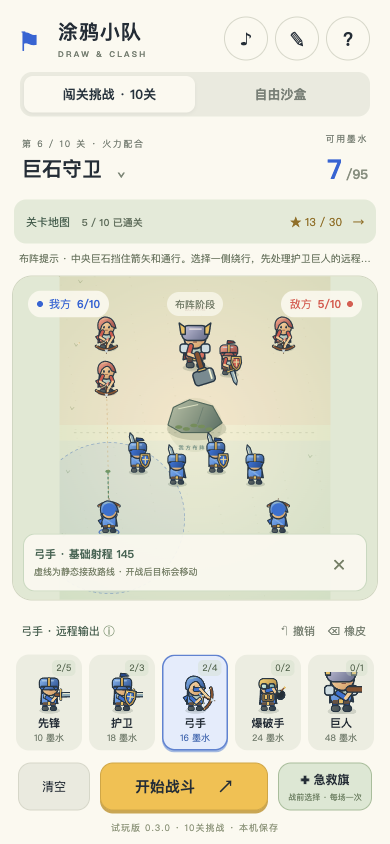
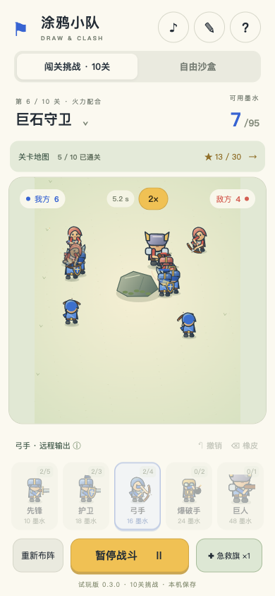

# 涂鸦小队 · Draw & Clash

用有限的墨水画出你的小队，开战后士兵自动寻敌作战；输了就看复盘、挪一挪站位，再来一次。原创 H5 战术小游戏，竖屏触控优先，纯原生 JavaScript + Canvas 2D，零依赖。

*Draw your squad on a limited ink budget, then watch it fight on its own. An original, mobile-first H5 tactics game in vanilla JavaScript and Canvas 2D. The UI is Chinese for now; English localization is planned.*

<p>
  
  
  
</p>

当前版本：**0.3.0 试玩版**。单机游戏，没有账号、联网对战、广告或付费。

## 玩法

- **布阵**：把兵种卡拖进己方区域，或点按、滑动直接“画”出一排士兵。已放的士兵可以拖动调整、拖回回收，支持撤销和橡皮。每关有墨水预算，全队最多 10 人。
- **五个兵种**：
  - 先锋：近战突击。
  - 护卫：受到的远程伤害减少 45%。
  - 弓手：直线射箭，会被巨石和路径上的敌人挡住。
  - 爆破手：越过巨石投弹，造成范围伤害。
  - 巨人：重型前排，通关第 3 关后解锁。
- **10 个手工关卡**：分三章逐步变难，包含盾墙、密集冲锋、左右夹击、窄口等布局；巨石既挡路也挡箭。
- **战术道具**：急救旗、集结号、烟雾弹，每场带一件，限用一次。
- **看得懂的战斗**：布阵时点选士兵，可以预览射程和接敌路线；战后复盘列出各兵种的输出、承伤和最早阵亡，帮你决定下一次怎么改。
- **三星与挑战**：获胜、至少半数存活、25 秒内获胜各得一星；部分关卡另有可选挑战。
- **手感**：
  - 2 倍速。
  - 胜负揭晓时的慢动作停顿。
  - 爆炸震屏，以及支持的设备上的震动反馈。
  - 按动作合成的音效。
  - 系统开启“减少动态效果”时，会关闭震屏和多余的动画。
- **自由沙盒**：自己摆红蓝两队对打。

进度、阵容和试玩记录只保存在当前浏览器，不会上传。

## 本地运行

需要 Python 3，只用来起一个静态服务器。ES 模块必须通过 HTTP 加载，不能直接双击 `index.html`。

```bash
python3 serve.py
```

然后打开 http://127.0.0.1:5183 。Mac 也可以双击 `start.command`。端口被占用时加 `--port 5184`。想在同一 Wi-Fi 下用手机试玩：

```bash
python3 serve.py --host 0.0.0.0
```

## 测试

需要 Node.js 18 或更高版本，不用安装依赖：

```bash
node --test tests/*.test.mjs
```

测试覆盖：
- 模拟规则；
- 布阵校验；
- 旧存档兼容；
- 每关都存在合法的通关阵容；
- 改变阵容或站位能把失败变成胜利。

## 关卡难度体检

```bash
node tools/level-report.mjs
```

这个工具用大量“按常识但随手”的合法阵容模拟每一关。它输出随手布阵的胜率、三星率和胜局用时，以及局部搜索找到的最好成绩，用来校准难度曲线。随机胜率只反映关卡之间的相对难度，不能代替真人试玩。

常用参数：
- `--sweep 1,0.85,0.75`：按原预算的倍数扫描；
- `--budgets 90,105,…`：试一组新预算；
- `--json 路径`：导出完整结果。

## 构建与部署

```bash
python3 release/build_web.py
```

这条命令生成 `dist/web`：
- 只包含页面、样式、图标和 `src/*.mjs`，并检查所有模块引用都在包里；
- 页面设置为不被搜索引擎收录；
- 附带的 `_headers` 让浏览器每次打开都确认最新版本，避免更新后新旧文件混用。

线上版本由 Cloudflare Pages 连接本仓库自动构建：推送到 `main` 就会发布正式版本，其他分支和 PR 会得到各自的预览链接。Pages 项目的构建设置：

| 设置 | 值 |
| --- | --- |
| Production branch | `main` |
| Framework preset | None |
| Build command | `python3 release/build_web.py` |
| Build output directory | `dist/web` |

需要发给别人的本地试玩压缩包（含启动器和试玩说明）用 `python3 release/build_playtest.py` 生成，输出到 `dist/`。版本号统一写在 `release.json`。

## 目录结构

| 路径 | 内容 |
| --- | --- |
| `index.html`、`styles.css` | 页面结构与触屏界面 |
| `src/engine.mjs` | 纯模拟：布阵校验、寻敌、移动、攻击、道具、胜负 |
| `src/data.mjs` | 兵种数值、道具和 10 个关卡 |
| `src/render.mjs` | Canvas 角色与战场绘制、特效、胜负横幅 |
| `src/app.mjs` | 界面、存档、音效、震动和主循环 |
| `src/formation-input.mjs` | 触屏和鼠标的布阵手势 |
| `src/terrain.mjs`、`src/combat.mjs` | 巨石寻路与碰撞；模拟和渲染共用的几何工具 |
| `src/tactical-preview.mjs`、`src/battle-report.mjs` | 战术预览与战后复盘 |
| `src/progression.mjs`、`src/campaign.mjs`、`src/drafts.mjs` | 进度、关卡地图、阵容存档校验 |
| `src/first-session.mjs`、`src/playtest.mjs` | 新手引导与本机试玩记录 |
| `tests/` | `node:test` 测试和通关样本 |
| `tools/level-report.mjs` | 关卡难度体检 |
| `release/` | 网页包与本地试玩包脚本 |
| `previews/` | 开发过程截图 |

## 文档

- [PLAYTEST.md](PLAYTEST.md)：给试玩者的说明和反馈方式。
- [docs/DEVLOG.md](docs/DEVLOG.md)：各轮迭代的设计决策和实现细节。

## 接下来

- 找真人试玩，校准新的难度曲线（当前每关预算 90–145 墨水）。
- 做英文本地化，准备面向海外发行。
- 玩法稳定后，评估打包成手机 App。

## 说明

玩法形式受“先画部队、再自动战斗”这类游戏启发；界面、角色图形、数值和代码都是本项目原创，没有使用任何参考作品的代码或素材。项目暂未添加开源许可证。
