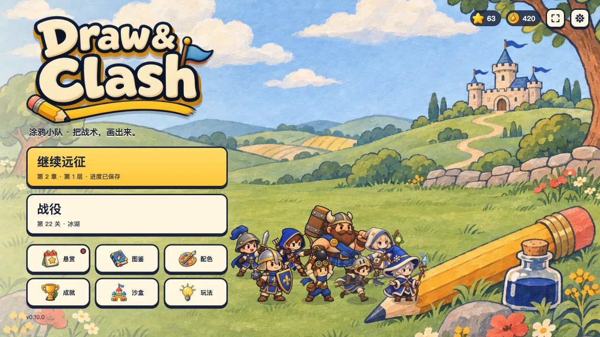
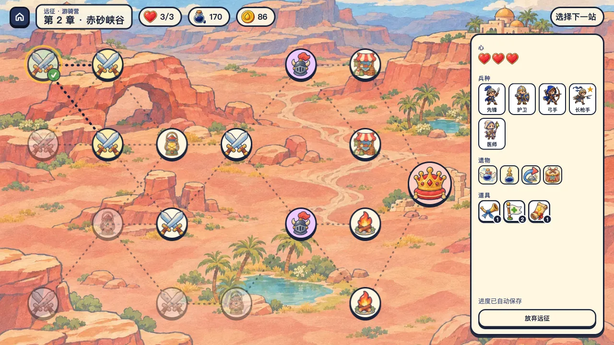
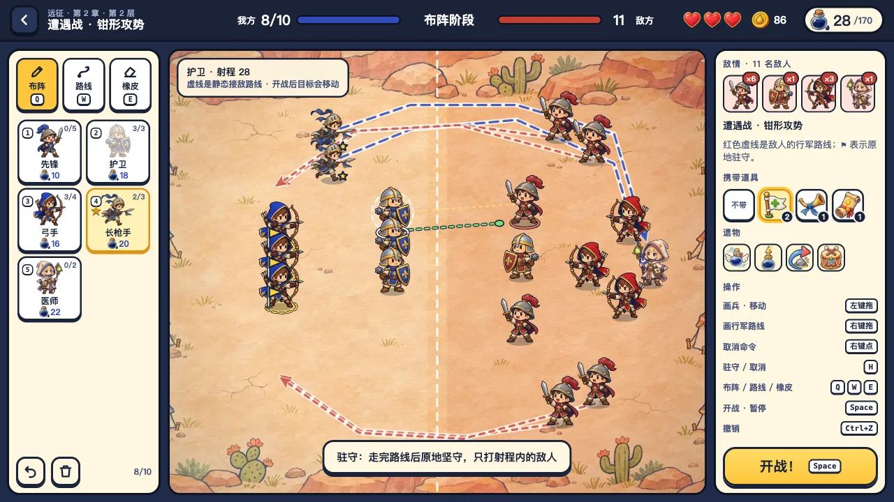
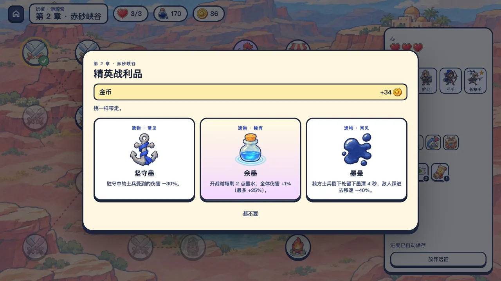

# Draw & Clash · 涂鸦小队

用有限的墨水画出你的小队，再给他们画好行军路线；开战后士兵自己沿线行军、寻敌作战。原创战术游戏，现在是**电脑版**：横屏、鼠标键盘操作，主打肉鸽式的“远征”模式，另有 40 关战役。纯原生 JavaScript + Canvas 2D，没有任何运行时依赖。

*Draw your squad on a limited ink budget, draw their march routes, then watch them fight on their own. An original tactics game for PC (landscape, mouse and keyboard) with a roguelike Expedition mode and a 40-level campaign. Vanilla JavaScript and Canvas 2D, playable in Chinese and English.*

<p>
  
  
  
  
</p>

**在线试玩：<https://doodle-battles-h5.pages.dev>**（请用电脑浏览器打开；界面按 1280×720 设计，会随窗口等比缩放；页面暂时不会被搜索引擎收录）

当前版本：**0.10.0**（电脑版原型）。单机游戏，没有账号、联网对战、广告或付费，进度只保存在当前浏览器。

## 核心玩法：把战术画出来

- **画兵**：选好兵种，在左侧蓝色区域按住左键拖动，一笔画出一排士兵。墨水有限，人数也有上限。
- **画路线**：右键从士兵身上拖出一条线（或按 W 换路线笔）。开战后他会沿线行军，射程内有敌人才停下来打，走完路线后照常寻敌。绕后、诱敌、集火都靠画。
- **圈选与队形**：用路线笔在空地上画个圈，可以选中一群人；从其中一人身上画一笔路线，大家保持队形一起走。
- **驻守**：按 H 让选中的人驻守，走完路线后原地坚守，只打够得着的敌人。

敌人也会有路线：布阵时，敌方的包抄路线用红色虚线画出来，驻守的敌人插着红色小旗。

## 远征（肉鸽模式）

- 一局三章：青草原、赤砂峡谷、霜雪原。每章一张分岔地图，6 层节点加 1 个首领。
- 节点：遭遇战、精英战、首领、奇遇、军需官（商店）、营火、宝箱。
- 开局选编制：铁卫营、游骑营、炮术营，各有起始兵种、一件遗物和道具。
- 打赢普通战后三选一：新兵种、精锐升级、墨水上限或道具；精英战掉遗物；首领回满心、墨水上限 +20、掉稀有遗物。
- **14 件遗物**会改变规则，例如：行军更快、走完路线后第一击翻倍、从背后砍中加伤、驻守减伤、阵亡处留下减速墨潭、剩余墨水转成伤害。
- 3 颗心：输一场扣一颗，可以调整布阵（路线也保留）后重打；心用光远征结束。结束时按走过的路程把金币带回主线。
- 遭遇战按种子生成，敌军规模随层数增长，后两章靠属性强化继续变难。

## 战役（40 关）

- **40 个手工关卡，4 个章节**：青草原、赤砂峡谷、霜雪原、王城。每章 10 关，最后一关是首领战。关卡包含盾墙、夹击、窄口、水塘、护城河等布局。
- **8 个兵种**，随进度解锁：
  - 先锋：便宜的近战。
  - 护卫：受到的远程伤害减少 45%。
  - 弓手：直线射箭，会被巨石和路径上的敌人挡住。
  - 爆破手：越过巨石投弹，造成范围伤害。
  - 巨人：重型前排。
  - 长枪手：绕过前排直奔敌方后排，助跑后的第一击伤害是平时的 2.4 倍。
  - 医师：持续治疗射程内伤得最重的队友。
  - 冰法师：冰球造成范围伤害并减速。
- **5 件战术道具**，每场带一件、限用一次：急救旗、烟雾罐、集结号、落雷符（点选落点）、冰封瓶（冻住全部敌人）。
- **三星与挑战**：获胜、至少半数存活、限时内获胜各得一星；8 个关卡另有可选挑战。
- **局外成长**（都不影响数值）：金币买军旗配色；卡关时可以花金币看“军师锦囊”（一个测试中不靠道具也能获胜的阵型）；每日悬赏、24 个成就。
- **其他**：自由沙盒、新手引导、图鉴（兵种、道具、遗物）、2 倍速、中英文切换、全屏、减少动效选项。

## 操作

| 操作 | 按键 |
| --- | --- |
| 画兵 · 移动士兵 | 左键拖动（拖回左栏回收） |
| 画行军路线 | 右键从士兵身上拖动，或按 W 后左键拖动 |
| 取消某人的路线和驻守 | 右键单击士兵 |
| 圈选多人 | 路线笔（W）在空地上画圈；Shift 加选；Ctrl+A 全选 |
| 驻守 / 取消 | H |
| 选兵种 | 1–8 |
| 布阵笔 / 路线笔 / 橡皮 | Q / W / E |
| 开战 · 暂停 | 空格 |
| 撤销 | Ctrl+Z |
| 撤回选中的士兵 | Delete |
| 使用道具 · 倍速 | R · F |

## 本地运行

需要 Python 3，只用来起一个静态服务器。ES 模块必须通过 HTTP 加载，不能直接双击 `index.html`。

```bash
python3 serve.py
```

然后用电脑浏览器打开 http://127.0.0.1:5183 。Mac 也可以双击 `start.command`。端口被占用时加 `--port 5184`。

## 测试

需要 Node.js 18 或更高版本，不用安装依赖：

```bash
node --test tests/*.test.mjs
```

共 131 个测试，覆盖：

- 模拟规则：寻敌、转向、弹道、障碍、各兵种和道具的效果；行军路线、驻守和 14 件遗物的效果。
- 远征：地图连通、遭遇战生成、奖励、商店、营火、奇遇、整局流程和存档校验。
- 布阵校验和存档校验，包括旧版存档迁移（竖版阵容自动换算成横版）和被改坏的存档。
- 金币、配色、锦囊、每日悬赏和成就的发放规则。
- 每一关都有一个不靠道具也能获胜的阵容。
- 中英文文案条目一一对应。

## 关卡难度工具

```bash
node tools/level-report.mjs
```

这个工具用大量“按常识但随手”的合法阵容模拟每一关，输出随手布阵的胜率、三星率和胜局用时，再用局部搜索找出能达到的最好成绩。随机胜率只反映关卡之间的相对难度，不能代替真人试玩。

常用参数：

- `--tune`：按内置的目标难度曲线，给出每关的建议预算。
- `--sweep 1,0.85,0.75`：按原预算的倍数扫描。
- `--budgets 90,105,…`：试一组新预算。
- `--solutions tests/fixtures/level-solutions.json`：为每关搜索不靠道具的通关阵容并写入样本文件。之后运行 `node tools/export-solutions.mjs`，把样本导出成游戏内“军师锦囊”用的 `src/solutions.mjs`。

当前 40 关的预算在 90–210 墨水之间。随机胜率在每章开头较高（第 1 关约 100%，第 11、21、31 关约 40%–55%），章末降到 10%–20%。

远征的难度用另一个工具检查：

```bash
node tools/run-report.mjs [--seeds 30] [--plans 12]
```

它按章节和层数生成遭遇战，用该阶段常见的兵种、遗物和预计墨水随手布阵（不画路线、不用道具）模拟，输出随手胜率。当前大致是：第一章普通战 60%–95%、第二章 40%–70%、第三章 35%–50%；精英 20%–50%，首领 25%–50%。真人会画路线、挑遗物和升级，实际会更容易一些。

## 美术与音频

- **美术**：背景、关卡地图、角色、道具和界面图标由图像生成模型生成，提示词和尺寸记录在 `art/jobs/images.json`。原图体积大，放在 `art/inbox/`，不进仓库。
- **素材处理**：`tools/build-assets.sh` 把原图裁剪、缩放并转成 WebP，输出到 `assets/`（共约 4MB）。需要 ImageMagick 和 cwebp。
- **队伍配色**：角色原图的队伍色是宝蓝色。游戏加载后按色相把这部分像素替换成红队或其他配色，所以敌我两队和所有配色共用同一套图。
- **朝向与动画**：战场是左右对战，我方默认朝右、敌方朝左。每个角色有正面和背面两张贴图：往上走或往上打时显示背面，其余显示正面，左右靠水平翻转。走路弹跳、攻击前倾、受击闪白和倒地都由代码完成。
- **电脑版界面**：整个界面画在 1280×720 的舞台上，按窗口大小等比缩放，画布按实际像素重新分配分辨率，所以 1080p、2K 下也清晰。
- **击杀特效**：士兵倒下时迸出星星和碎片、一圈冲击环和烟团，并在地上留下一摊队伍颜色的墨迹。开启“减少动效”时关闭。
- **音频**：全部用 WebAudio 实时合成，没有音频文件。包括约 25 种音效，以及菜单和战斗两段原创循环配乐。

## 构建与部署

```bash
python3 release/build_web.py
```

这条命令生成 `dist/web`：

- 只包含页面、样式、`src/`、`assets/`、应用清单和离线缓存脚本，并检查所有引用的文件都在包里。
- 离线缓存的版本号带内容指纹，任何文件变化都会让旧缓存失效。
- 页面设置为不被搜索引擎收录；正式发行时去掉 `build_web.py` 里的两处 robots 设置即可。

线上版本由 Cloudflare Pages 项目 `doodle-battles-h5` 连接本仓库自动构建：推送到 `main` 就会发布正式版本，其他分支和 PR 会得到各自的预览链接。构建设置：

| 设置 | 值 |
| --- | --- |
| Production branch | `main` |
| Framework preset | None |
| Build command | `python3 release/build_web.py` |
| Build output directory | `dist/web` |

需要发给别人的本地试玩压缩包（含启动器和试玩说明）用 `python3 release/build_playtest.py` 生成，输出到 `dist/`。版本号统一写在 `release.json`。

## 目录结构

| 路径 | 内容 |
| --- | --- |
| `index.html`、`styles.css` | 页面骨架与界面样式 |
| `src/data.mjs` | 兵种、道具、章节和 40 个关卡的数据（中英文） |
| `src/engine.mjs` | 纯模拟：布阵校验、寻敌、移动、行军路线与驻守、攻击、道具、遗物效果、胜负 |
| `src/routes.mjs` | 把鼠标轨迹整理成行军路线 |
| `src/run.mjs`、`src/encounters.mjs`、`src/relics.mjs` | 远征规则：地图、遭遇战生成、奖励、商店、营火、奇遇；遗物与精锐升级 |
| `src/run-ui.mjs` | 远征界面：选编制、地图和各个节点弹窗 |
| `src/terrain.mjs`、`src/combat.mjs` | 障碍寻路与碰撞；模拟和渲染共用的几何工具 |
| `src/render.mjs`、`src/assets.mjs` | 战场绘制、角色动画与特效；图片加载与换色 |
| `src/audio.mjs` | 音效与配乐合成 |
| `src/app.mjs` | 启动、舞台缩放、主页、战役地图和各个弹窗 |
| `src/battle.mjs`、`src/formation-input.mjs` | 战斗界面（战役、沙盒、远征共用）；鼠标布阵、画路线和圈选 |
| `src/save.mjs`、`src/meta.mjs` | 存档；金币、配色、锦囊、悬赏和成就 |
| `src/i18n.mjs`、`src/i18n-run.mjs` | 中英文文案（后者是电脑版和远征新增的部分） |
| `src/first-session.mjs` | 新手引导与可选挑战 |
| `src/tactical-preview.mjs`、`src/battle-report.mjs` | 战术预览与战后复盘 |
| `src/solutions.mjs` | 每关的锦囊阵型（由工具生成） |
| `tests/` | `node:test` 测试和通关样本 |
| `tools/` | 关卡和远征的难度工具、样本导出、素材处理 |
| `art/jobs/images.json` | 生图任务清单（提示词） |
| `assets/` | 游戏用的图片 |
| `release/` | 网页包与本地试玩包脚本 |

## 文档

- [PLAYTEST.md](PLAYTEST.md)：给试玩者的说明和反馈方式。
- [docs/DEVLOG.md](docs/DEVLOG.md)：各轮迭代的设计决策和实现细节。

## 接下来

- 找真人试玩“画路线 + 远征”这套玩法，确认它比原来的摆兵更有意思，再决定往哪个方向加内容。
- 远征的难度目前只经过自动模拟校准；遗物和事件的数量还少，多玩几局会开始重复。
- 打包成桌面程序（例如 Electron 或 Tauri）并准备 Steam 商店页和试玩版。
- 战役的 40 关是从竖版换算过来的，还没有专门为路线玩法重新设计。

## 说明

玩法形式受“先画部队、再自动战斗”这类游戏启发；规则、关卡、数值、界面和代码都是本项目原创，没有使用任何参考作品的代码或素材。美术由图像生成模型按本项目的提示词生成。项目暂未添加开源许可证。
