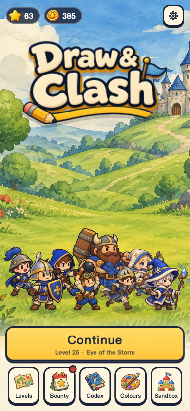
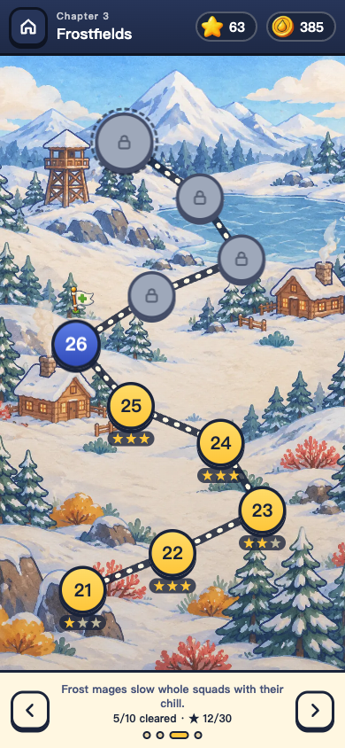
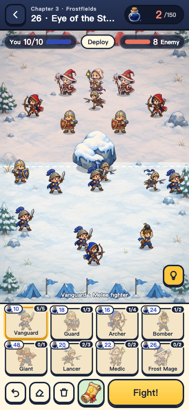
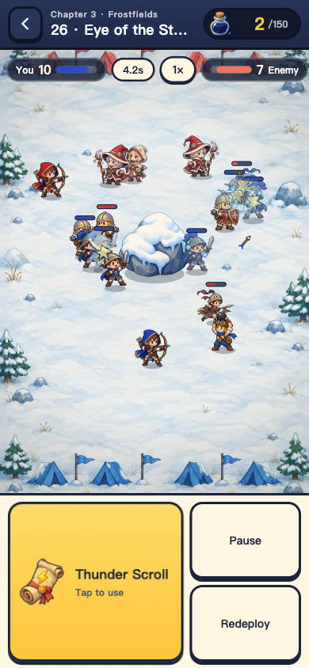

# Draw & Clash · 涂鸦小队

用有限的墨水画出你的小队，开战后士兵自动寻敌作战；输了就看复盘、挪一挪站位，再来一次。原创 H5 战术游戏，竖屏触控优先，纯原生 JavaScript + Canvas 2D，没有任何运行时依赖。

*Draw your squad on a limited ink budget, then watch it fight on its own. An original, mobile-first tactics game with 40 hand-made levels, 8 unit types and 5 tactical items. Vanilla JavaScript and Canvas 2D, playable in Chinese and English.*

<p>
  
  
  
  
</p>

**在线试玩：<https://doodle-battles-h5.pages.dev>**（手机竖屏体验最好；可以“添加到主屏幕”离线玩；页面暂时不会被搜索引擎收录）

当前版本：**0.9.0**。单机游戏，没有账号、联网对战、广告或付费，进度只保存在当前浏览器。

## 游戏内容

- **40 个手工关卡，4 个章节**：青草原、赤砂峡谷、霜雪原、王城。每章 10 关，最后一关是首领战。关卡包含盾墙、夹击、窄口、水塘、护城河等布局。
- **8 个兵种**，随进度解锁：
  - 先锋：便宜的近战。
  - 护卫：受到的远程伤害减少 45%。
  - 弓手：直线射箭，会被巨石和路径上的敌人挡住。
  - 爆破手：越过巨石投弹，造成范围伤害。
  - 巨人：重型前排。
  - 长枪手：绕过前排直奔敌方后排，助跑后的第一击伤害是平时的 2.4 倍。
  - 医师：持续治疗射程内伤得最重的队友。
  - 冰法师：冰球造成范围伤害并减速。
- **5 件战术道具**，每场带一件、限用一次：急救旗、烟雾罐、集结号、落雷符（点选落点）、冰封瓶（冻住全部敌人）。
- **布阵**：把兵种卡拖进己方区域，或点按、滑动直接“画”出一排士兵；可以拖动调整、拖回回收、撤销和擦除。每关有墨水预算，全队最多 10 人。
- **看得懂的战斗**：布阵时点选士兵可以预览射程和接敌路线；战后复盘列出各兵种的输出、承伤和最早阵亡。
- **三星与挑战**：获胜、至少半数存活、限时内获胜各得一星；8 个关卡另有可选挑战。
- **局外成长**（都不影响数值）：
  - 通关和拿星获得金币。
  - 金币可以购买 5 种军旗配色。
  - 卡关时可以花金币看“军师锦囊”：一个测试中不靠道具也能获胜的阵型。
  - 每日悬赏、22 个成就。
- **其他**：自由沙盒、新手引导、兵种图鉴、2 倍速、中英文切换、震动反馈、减少动效选项。

## 本地运行

需要 Python 3，只用来起一个静态服务器。ES 模块必须通过 HTTP 加载，不能直接双击 `index.html`。

```bash
python3 serve.py
```

然后打开 http://127.0.0.1:5183 。Mac 也可以双击 `start.command`。端口被占用时加 `--port 5184`。想在同一 Wi-Fi 下用手机试玩：

```bash
python3 serve.py --host 0.0.0.0
```

## 测试

需要 Node.js 18 或更高版本，不用安装依赖：

```bash
node --test tests/*.test.mjs
```

共 114 个测试，覆盖：

- 模拟规则：寻敌、转向、弹道、障碍、各兵种和道具的效果。
- 布阵校验和存档校验，包括旧版存档迁移和被改坏的存档。
- 金币、配色、锦囊、每日悬赏和成就的发放规则。
- 每一关都有一个不靠道具也能获胜的阵容。
- 中英文文案条目一一对应。
- 发布流程：版本号处处一致，当前版本写了更新记录。

## 关卡难度工具

```bash
node tools/level-report.mjs
```

这个工具用大量“按常识但随手”的合法阵容模拟每一关，输出随手布阵的胜率、三星率和胜局用时，再用局部搜索找出能达到的最好成绩。随机胜率只反映关卡之间的相对难度，不能代替真人试玩。

常用参数：

- `--tune`：按内置的目标难度曲线，给出每关的建议预算。
- `--sweep 1,0.85,0.75`：按原预算的倍数扫描。
- `--budgets 90,105,…`：试一组新预算。
- `--solutions tests/fixtures/level-solutions.json`：为每关搜索不靠道具的通关阵容并写入样本文件。之后运行 `node tools/export-solutions.mjs`，把样本导出成游戏内“军师锦囊”用的 `src/solutions.mjs`。

当前 40 关的预算在 90–210 墨水之间。随机胜率在每章开头较高（第 1 关约 100%，第 11、21、31 关约 40%–55%），章末降到 10%–20%。

## 美术与音频

- **美术**：背景、关卡地图、角色、道具和界面图标由图像生成模型生成，提示词和尺寸记录在 `art/jobs/images.json`。原图体积大，放在 `art/inbox/`，不进仓库。
- **素材处理**：`tools/build-assets.sh` 把原图裁剪、缩放并转成 WebP，输出到 `assets/`（共约 2.3MB）。需要 ImageMagick 和 cwebp。
- **队伍配色**：角色原图的队伍色是宝蓝色。游戏加载后按色相把这部分像素替换成红队或其他配色，所以敌我两队和所有配色共用同一套图。
- **动画**：角色是单张贴图，走路弹跳、攻击前倾、受击闪白和倒地都由代码完成。
- **音频**：全部用 WebAudio 实时合成，没有音频文件。包括约 25 种音效，以及菜单和战斗两段原创循环配乐。

## 构建与部署

```bash
python3 release/build_web.py
```

这条命令生成 `dist/web`：

- 只包含页面、样式、`src/`、`assets/`、应用清单和离线缓存脚本，并检查所有引用的文件都在包里。
- 离线缓存的版本号带内容指纹，任何文件变化都会让旧缓存失效。
- 页面设置为不被搜索引擎收录；正式发行时去掉 `build_web.py` 里的两处 robots 设置即可。

线上版本由 Cloudflare Pages 项目 `doodle-battles-h5` 连接本仓库自动构建：推送到 `main` 就会发布正式版本，其他分支和 PR 会得到各自的预览链接。构建设置：

| 设置 | 值 |
| --- | --- |
| Production branch | `main` |
| Framework preset | None |
| Build command | `python3 release/build_web.py` |
| Build output directory | `dist/web` |

需要发给别人的本地试玩压缩包（含启动器和试玩说明）用 `python3 release/build_playtest.py` 生成，输出到 `dist/`。

### 发布新版本

GitHub Actions 会自动发布 Release，不需要手动打标签：

1. 改 `release.json` 和 `src/playtest.mjs` 里的版本号（两处要一致，测试会检查）。
2. 在 [CHANGELOG.md](CHANGELOG.md) 最上面加上这一版的小节，它会成为 Release 说明。
3. 合并到 `main`。

`main` 上的版本号还没有对应的 Release 时，[release.yml](.github/workflows/release.yml) 会跑测试、打包，并发布 `v<版本号>`，附带两个文件：网页包 `draw-clash-web-<版本号>.zip` 和本地试玩包 `draw-clash-playtest-<版本号>.zip`。版本号没变时什么都不做。带连字符的版本号（例如 `1.0.0-beta.1`）会标记为预发布。

另外，[ci.yml](.github/workflows/ci.yml) 会在每个 PR 和每次推送到 `main` 时跑测试并确认发布包能打出来。想在本地检查打包结果，运行 `python3 release/build_release.py`。

## 目录结构

| 路径 | 内容 |
| --- | --- |
| `index.html`、`styles.css` | 页面骨架与界面样式 |
| `src/data.mjs` | 兵种、道具、章节和 40 个关卡的数据（中英文） |
| `src/engine.mjs` | 纯模拟：布阵校验、寻敌、移动、攻击、道具、胜负 |
| `src/terrain.mjs`、`src/combat.mjs` | 障碍寻路与碰撞；模拟和渲染共用的几何工具 |
| `src/render.mjs`、`src/assets.mjs` | 战场绘制、角色动画与特效；图片加载与换色 |
| `src/audio.mjs` | 音效与配乐合成 |
| `src/app.mjs` | 启动、主页、关卡地图和各个弹层 |
| `src/battle.mjs`、`src/formation-input.mjs` | 战斗界面；布阵手势 |
| `src/save.mjs`、`src/meta.mjs` | 存档；金币、配色、锦囊、悬赏和成就 |
| `src/i18n.mjs` | 中英文文案 |
| `src/first-session.mjs` | 新手引导与可选挑战 |
| `src/tactical-preview.mjs`、`src/battle-report.mjs` | 战术预览与战后复盘 |
| `src/solutions.mjs` | 每关的锦囊阵型（由工具生成） |
| `tests/` | `node:test` 测试和通关样本 |
| `tools/` | 关卡难度工具、样本导出、素材处理 |
| `art/jobs/images.json` | 生图任务清单（提示词） |
| `assets/` | 游戏用的图片 |
| `release/` | 网页包、本地试玩包和发布包的脚本，以及 Release 说明生成 |
| `.github/workflows/` | CI 和自动发布 |

## 文档

- [CHANGELOG.md](CHANGELOG.md)：每个版本的更新记录。
- [PLAYTEST.md](PLAYTEST.md)：给试玩者的说明和反馈方式。
- [docs/DEVLOG.md](docs/DEVLOG.md)：各轮迭代的设计决策和实现细节。

## 接下来

- 找真人试玩。新增的 30 关、3 个兵种和 2 件道具的难度目前只经过自动模拟校准。
- 在真实的 iPhone 和安卓手机上检查性能、触控手感和音频。
- 评估打包成手机 App，以及海外发行需要的统计、广告或内购接入。

## 说明

玩法形式受“先画部队、再自动战斗”这类游戏启发；规则、关卡、数值、界面和代码都是本项目原创，没有使用任何参考作品的代码或素材。美术由图像生成模型按本项目的提示词生成。项目暂未添加开源许可证。
